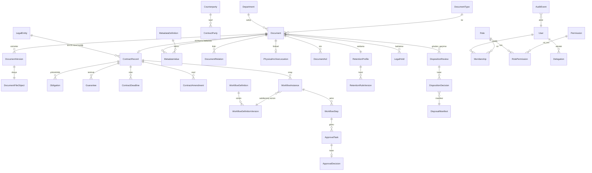
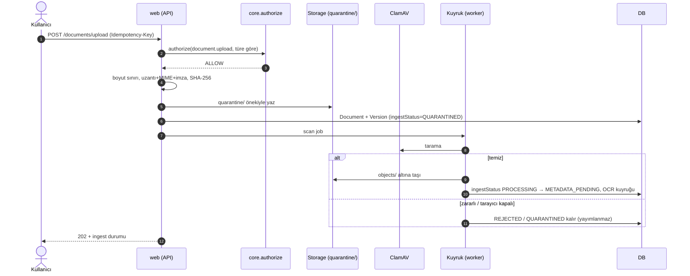
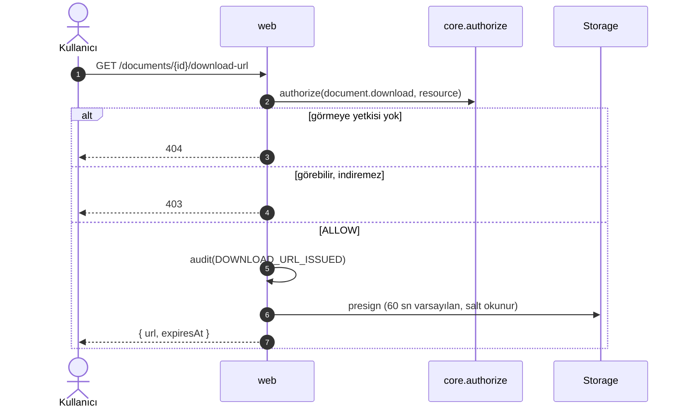
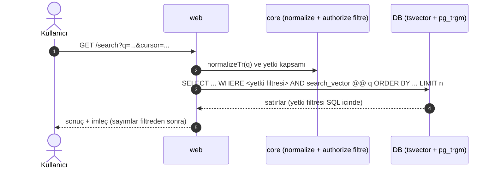
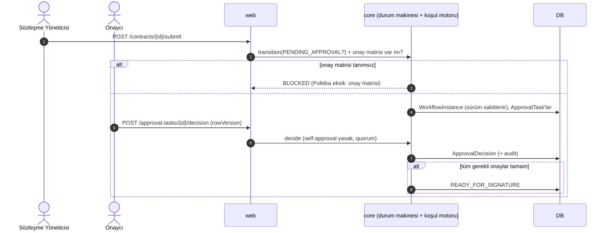
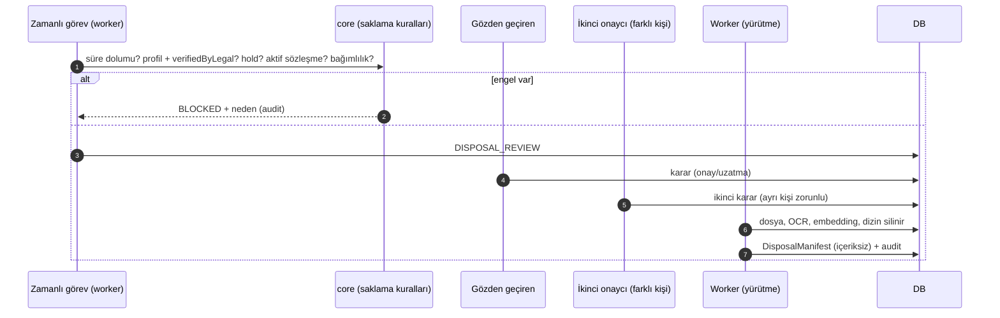

# EKOS EDMS — Mimari Sözleşme

> Durum: **Faz 0a** (kodlandı, yerel doğrulama bekliyor). Bu doküman sonraki fazların bağlayıcı çerçevesidir. Değişiklik yalnızca yeni bir ADR (`docs/DECISIONS.md`) ile yapılır.

## 1. Amaç ve kapsam

EKOS EDMS, tedarikçi ve danışman sözleşmelerinin yaşam döngüsünü (CLM) ve bunun üzerine kurulu ortak belge yönetimi altyapısını sağlar. İlk teslim değeri sözleşme yönetimidir; altyapı satın alma, üretim, mali işler, kalite, ithalat/ihracat, iç denetim ve İK belgelerini de kaldırmadan taşıyacak şekilde genel tasarlanır.

Bu doküman bir **iddia** değil, bir **tasarım sözleşmesidir**: "uygulandı" ifadesi yalnızca ilgili test ve `docs/TRACEABILITY.md` kaydıyla kullanılabilir.

## 2. Modül haritası

```
ekos-edms/
├─ apps/
│  ├─ web/          Next.js (App Router): UI + API route handler'ları. İş kararı vermez.
│  └─ worker/       BullMQ tüketicileri: OCR, tarama, hatırlatma, bildirim, saklama yürütmesi.
├─ packages/
│  ├─ core/         Saf TypeScript iş kuralları: yetki motoru, durum makineleri, tarih, saklama.
│  ├─ db/           Prisma şeması (çok dosyalı) ve migration'lar.           [şema: Faz 0b]
│  └─ adapters/     Dış sistem sınırları: storage, antivirus, ocr, mail, teams, esign, sso, erp, ai.
├─ docker/          compose + Dockerfile'lar
├─ e2e/             Playwright senaryoları
└─ docs/            Mimari, ADR, izin matrisi, izlenebilirlik
```

### 2.1 Bağımlılık kuralları (zorunlu)

| Kaynak              | Bağımlı olabilir                             | Bağımlı OLAMAZ                          |
| ------------------- | -------------------------------------------- | --------------------------------------- |
| `packages/core`     | (yalnızca saf TS, tip/yardımcı kütüphaneler) | Next, Prisma, Redis, S3, HTTP, `apps/*` |
| `packages/adapters` | `core` (tipler)                              | `apps/*`                                |
| `packages/db`       | —                                            | `apps/*`, UI                            |
| `apps/web`          | `core`, `db`, `adapters`                     | —                                       |
| `apps/worker`       | `core`, `db`, `adapters`                     | `apps/web`                              |

Kural: **Tüm iş kuralları `packages/core`'dadır.** API ve worker bunu çağırır. UI hiçbir geçerlilik veya yetki kararı vermez. Bu kural bir ESLint `no-restricted-imports` kuralı ile Faz 1'de zorunlu kılınacaktır (bkz. TRACEABILITY).

### 2.2 Katmanlar (bir istek içinde)

1. **Sınır (`apps/web/app/api/**`)**: `withAuth(permission, resolver)` sarmalayıcısı, zod doğrulama, correlation ID, rate limit, standart hata biçimi `{code, message, correlationId}`.
2. **Uygulama servisi (`apps/web/lib` veya `packages/core` çağrıları)**: transaction sınırı, `Idempotency-Key`, `rowVersion` kontrolü.
3. **Çekirdek (`packages/core`)**: `authorize()`, durum geçişleri, tarih/saklama kuralları. Saf fonksiyonlar.
4. **Kalıcılık (`packages/db`)**: Prisma; yalnızca parametrik sorgu.
5. **Dış sistemler (`packages/adapters`)**: arayüz + sağlayıcı. Yapılandırılmamış = `NOT_CONFIGURED`.

Worker aynı 2–5 katmanlarını kullanır; sınırı yerine kuyruk mesajı ve deneme/hata kuyruğu geçer.

## 3. Çalışma zamanı topolojisi

| Bileşen        | Teknoloji                           | Not                                  |
| -------------- | ----------------------------------- | ------------------------------------ |
| Web            | Next.js (App Router), Node          | Modüler monolit; mikroservis yok     |
| Worker         | Node + BullMQ                       | Redis kuyrukları                     |
| PostgreSQL 16  | `tsvector`, `pg_trgm`, `unaccent`   | Ana veri, audit, arama               |
| Redis 7        | BullMQ, rate limit                  | Kalıcı kayıt tutulmaz                |
| Nesne depolama | S3 uyumlu (geliştirmede MinIO)      | Özel bucket, herkese açık URL yok    |
| ClamAV (clamd) | Antivirüs                           | Erişilemezse dosya karantinada kalır |
| OCR            | ocrmypdf / Tesseract (`tur`, `eng`) | Worker içinde                        |
| Log            | pino                                | Hassas alan redaksiyonu              |

## 4. Kimlik, oturum ve kimlik numaraları

- **Kimlik modu**: `AUTH_MODE=oidc | local` açıkça seçilir; varsayılan yoktur. `oidc` modunda yerel parolaya sessiz düşüş yoktur.
- **Oturum**: Auth.js, veritabanı oturumları; çerezler HttpOnly, Secure, SameSite.
- **Yerel mod**: argon2id, kilitleme, rate limit, TOTP; üretimde yalnızca açıkça etkinleştirildiğinde; "SSO yapılandırılmadı" uyarısı kalıcı.
- **İlk yönetici**: CLI ile üretilen tek kullanımlık kurulum belirteci. Varsayılan parola ve herkese açık kayıt yoktur.
- **İç kimlik**: UUIDv7 (değişmez). **İnsan okunur numara**: `EKOS-{TÜRKODU}-{YIL}-{6 hane}`; tür+yıl sayacı, işlem içinde, çakışmasız.

## 5. Yetkilendirme modeli

Tek fonksiyon: `authorize(actor, permissionCode, resource)` (`packages/core`). Varsayılan **reddet**.

```
authorize(actor, code, resource):
  1. code ∈ PERMISSION_CODES değilse → DENY
  2. Açık DENY (ACL) varsa → DENY            (DENY her zaman önceliklidir)
  3. Actor'ın kapsamlı üyelikleri (Membership) içinde code'u veren ve
     kapsamı (departmentIds, documentTypeIds, counterpartyIds, projectIds,
     maxConfidentiality, documentId) resource ile kesişen üyelik var mı?
     Yoksa → DENY
  4. Açık ALLOW (ACL) veya rol kapsamı yeterliyse → ALLOW; aksi DENY
  5. Break-glass bu kararı yalnızca süreli, gerekçeli, ikinci onaylı ve audit'li bir
     GRANT ile geçersiz kılabilir; sessiz arka kapı yoktur.
```

**404/403 kuralı**: Actor kaynağı görmeye hiç yetkili değilse **404**; görebiliyor ama eylem izni yoksa **403**. Bütün uç noktalarda tutarlıdır.

**Liste/arama**: Yetki filtresi sorgunun **içinde** uygulanır; sayımlar dahil sonuçlar filtreden sonra hesaplanır.

**Gizlilik**: `INTERNAL < CONFIDENTIAL < RESTRICTED < HIGHLY_RESTRICTED`. İK belge türleri varsayılan `HIGHLY_RESTRICTED`.

**Önbellek**: Yetki, dizin, önizleme, OCR metni, AI retrieval, bildirim metni ve dışa aktarma için aynıdır. İzin değişikliğinde ilgili önbellek ve dizin erişimi geçersiz kılınır.

Rol şablonları ve izin matrisi: `docs/PERMISSIONS.md`.

## 6. Durum makineleri

İki eksen ayrıdır ve karıştırılmaz:

- **Eksen 1 — `ingestStatus`**: `QUARANTINED → PROCESSING → METADATA_PENDING → READY`; hatalar: `REJECTED`, `FAILED_RETRYABLE`. `READY` olmayan belge yayımlanamaz.
- **Eksen 2 — `lifecycleStatus`**: iki profil.
  - _Genel_: `DRAFT → IN_REVIEW → PENDING_APPROVAL → APPROVED → ACTIVE → SUPERSEDED | ARCHIVED → DISPOSAL_REVIEW → DISPOSED`
  - _Sözleşme_: `DRAFT → IN_REVIEW → PENDING_APPROVAL → READY_FOR_SIGNATURE → PENDING_SIGNATURE → ACTIVE`; `ACTIVE ⇄ AMENDMENT_PENDING`; `ACTIVE → RENEWAL_REVIEW → ACTIVE | EXPIRED`; `ACTIVE → EXPIRED | TERMINATED`; `DRAFT..PENDING_SIGNATURE → CANCELLED`; `EXPIRED | TERMINATED | CANCELLED → ARCHIVED → DISPOSAL_REVIEW → DISPOSED`; her durumdan `INVALID` (yetkili, gerekçeli).
- **Hukuki bekletme** bayraktır (`legalHoldActive`), durum değildir; imha ve silmeyi her durumda bloke eder.

Geçişler `packages/core`'da **açık tablo** olarak tanımlanır; tabloda olmayan her geçiş reddedilir ve her geçiş için birim testi vardır. Backend tek doğrulayıcıdır.

Kritik kurallar: tüm gerekli onaylar tamamlanmadan `READY_FOR_SIGNATURE` olunamaz; imza kanıtı kaydedilmeden `ACTIVE` olunamaz; `ACTIVE` imzalı sürüm değiştirilemez (düzeltme = yeni sürüm veya zeyilname); `origin=IMPORTED_HISTORICAL` kayıtlar onay/imza süreci yaşanmış gibi gösterilmez.

## 7. Veri modeli (özet ERD)

Ayrıntılı alanlar ve indeksler Faz 0b'de `packages/db/prisma/schema/*.prisma` içinde tanımlanacaktır. Burada yalnızca ana ilişkiler gösterilir.



**Veri kuralları**: UUIDv7 kimlik; `rowVersion` (integer) ana kayıtlarda; `createdAt/updatedAt/createdBy/updatedBy`; zaman `timestamptz` UTC; sözleşme tarihleri `DATE` (`@db.Date`); para `NUMERIC(19,4)` + ISO 4217 kodu, JS tarafında `decimal.js`; ana kayıtlarda fiziksel silme yok (`onDelete: Restrict`); audit tablosu yalnızca INSERT.

## 8. İstek akışları

### 8.1 Belge yükleme



### 8.2 İndirme



### 8.3 Arama



### 8.4 Onay (sözleşme)



### 8.5 İmha



## 9. Dosya güvenliği

Yükleme hattı: boyut sınırı → uzantı + MIME + içerik imzası → SHA-256 → `quarantine/` → ClamAV → temiz ise `objects/` → OCR kuyruğu. Tarama servisi erişilemezse dosya karantinada kalır. Herkese açık URL yoktur. İndirme yalnızca yetki kontrolünden sonra, kısa ömürlü imzalı URL ile yapılır. Orijinal dosya ve OCR metni ayrı saklanır. Aynı SHA-256 → uyarı; otomatik silme/birleştirme yoktur. İmzalı sürüm salt okunurdur.

## 10. Güvenlik çizgisi (özet)

CSRF, XSS (çıktı kaçışlama + CSP), SQL injection (parametrik), IDOR, SSRF, path traversal, dosya yükleme saldırıları, güvenli çerezler, rate limit, güvenlik başlıkları. Hata yanıtı `{code, message, correlationId}`; secret, SQL, stack trace ve belge içeriği içermez. Secret yalnızca ortam değişkeni/secret manager'dan okunur.

## 11. Hukuki ve politika sınırları

Saklama süreleri, imza yetkileri, onay limitleri, tüzel kişilikler, departman sorumluları ve veri yerleşimi **yapılandırmadır**, kodlanmaz. Yapılandırma eksikse ilgili riskli işlem bloke edilir ve ekranda `Politika eksik: …` gösterilir. KVKK ve e-imza gibi konularda uyum **iddia edilmez**; ilgili noktalar "Hukuk/Veri Koruma incelemesi gerekir" ile işaretlenir.

## 12. Faz 0a kapsamı ve sınırları

Faz 0a: monorepo iskeleti, bu doküman seti, izin kataloğu, durum tipleri, Docker/CI iskeleti, minimal web ve worker süreçleri. **Yoktur**: Prisma şeması (0b), kimlik, yetki motoru mantığı, audit, depolama, yükleme, ekran işlevi.
